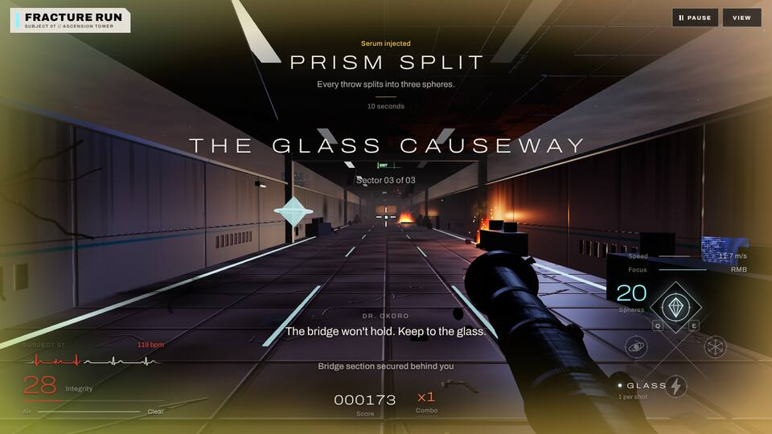
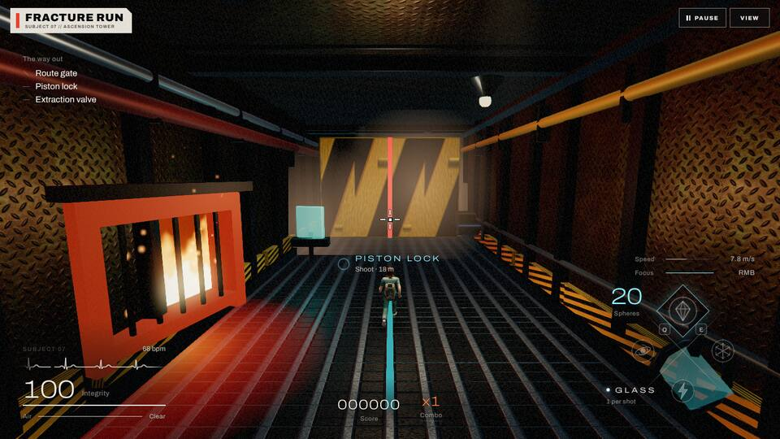
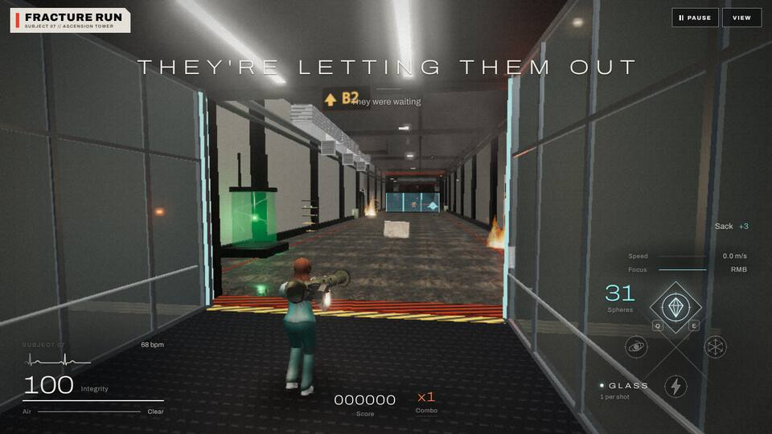
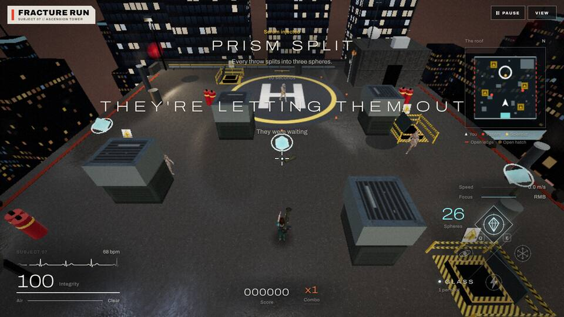
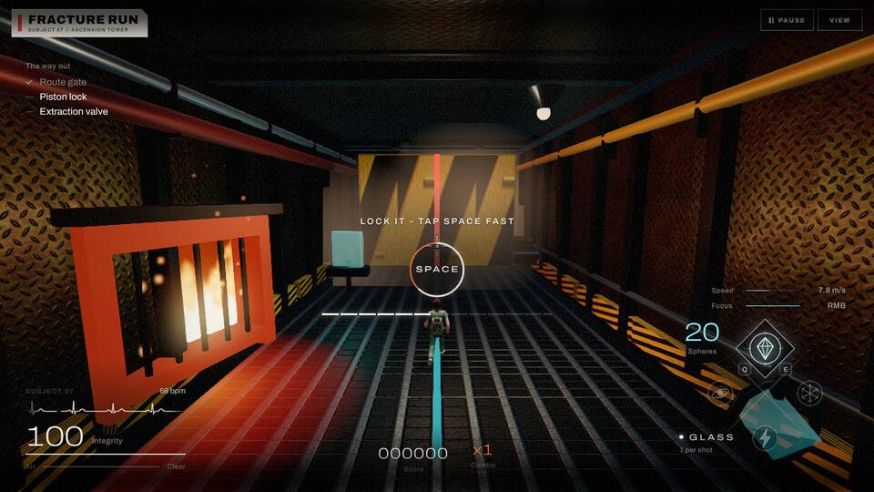
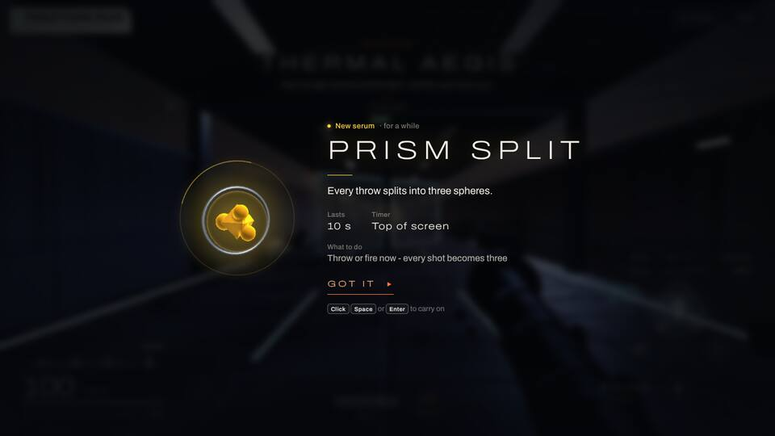
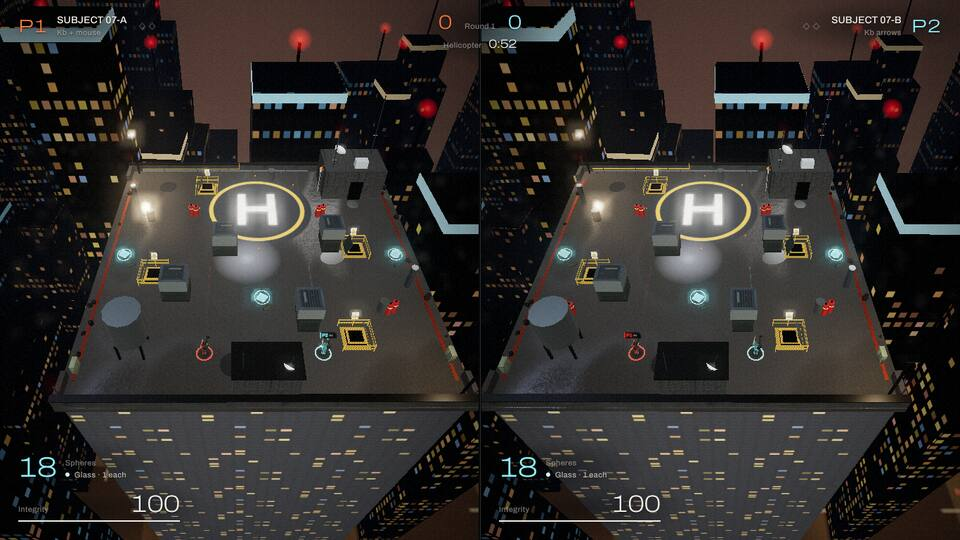
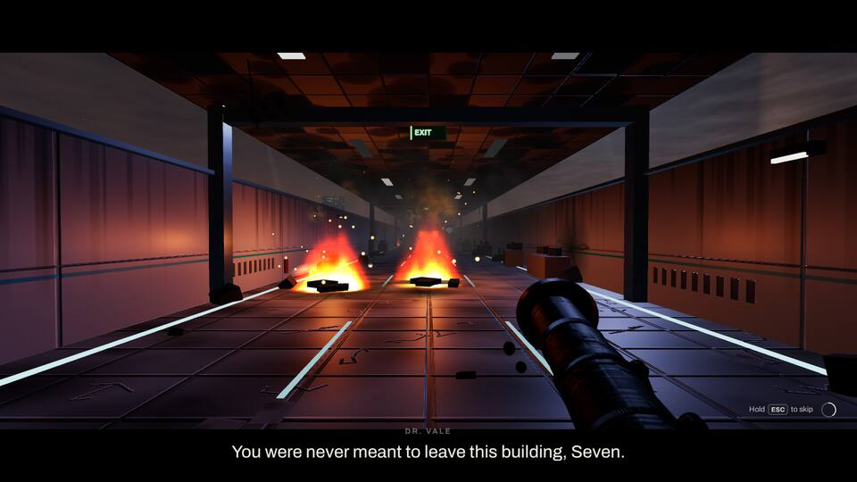

# The HUD: NIGHTFALL

The in-game interface follows the game's look, NIGHTFALL (`src/ui/theme.css`). The game is the picture, and the HUD is thin, clean light laid over it, the way film titles or a modern console HUD sit on a shot. Nothing is boxed: there are no plates, panels, tags, stamps, barcodes or hazard stripes.

## Rules

- **On the picture.** Text and numbers sit straight on the scene with `--shadow-text`. A group that has to read over a bright level (the Foundry's work lights, the Roof's sodium glare) gets a soft radial shade behind it (a `::before` with a `closest-side` radial gradient). The shade has no edge, so it never reads as a rectangle.
- **One family.** Archivo (variable) is the only typeface. Big numbers (integrity, spheres, score, floor) use the wide cut (`font-stretch: var(--wide)`) at a light weight (220-280) with tabular figures. Labels are small (11-13 px), in sentence case, in `--text-3`. Upper case appears only in the titles and in a few tiny tracked tags (a speaker's name, a key's name).
- **Hairlines, not bars.** Every meter is 1-3 px: integrity, air, speed, focus, combo decay, serum time, the mash and hold bars, the loading meter.
- **Colour means something.** `--blood` is damage and danger (low integrity breathes gently in it, as does the ECG when critical). `--glass` is what breaks (the sphere count, the switch to shoot). `--ember` is focus and the way forward (junction chevrons, the prompt to act, the button to carry on). `--warn` is a hazard on its way, `--ok` is a done thing. A serum's own colour only names that serum.
- **Calm motion.** Titles fade in over about a second while their tracking opens slightly. Warnings and low states breathe instead of blinking. Prompts kick a little on each press.

## Where things are

| Where | What | File |
| --- | --- | --- |
| Bottom left | Vitals: the heart trace (a thin warm-white line, blood when critical), integrity as a big light number over a hairline, the air | `src/ui/causeway-hud.css`, `.js` |
| Bottom centre | Score and combo, quiet. Above them the prompt lane (hints, "MASH SPACE") and, above that, the subtitles during play | `causeway-hud.css`, `meltdown-hud.css`, `src/story/story.css` |
| Bottom right | The sphere wheel: four thin rings on an X of hairlines, a fine diamond of light under the one in use, the count in glass. Speed and focus sit over it as two hairlines | `src/ui/sphere-wheel.css` |
| Top left | "The way out" (the Foundry's switches): plain lines with a thin tick, an ok check when done | `src/ui/foundry-hud.css` |
| Top right | The roof's map: a thin-outlined, translucent square (the frame shows through it), a quiet line over it, the key under it | `src/levels/meltdown/roof-map.js` |
| Top centre | Section titles (wide, thin, tracked, a hairline, a sentence-case line under), the serum announcement and its countdowns | `causeway-hud.css`, `foundry-hud.css`, `meltdown-hud.css`, `serum-fx.css` |
| Centre | Quick-time prompts: a clean key inside a thin ring that runs down with the time. Done is ok, held is ember, a miss is blood | `story.css`, `src/ui/mash-prompt.css` |

| The Foundry | The Labs |
| --- | --- |
|  |  |
| **The Roof** | **A quick-time prompt** |
|  |  |

## The rest

- **Subtitles** (`story.css`, and the lift's captions in `elevator-hud.css`): warm white, weight 420, a soft layered shadow and no box. The speaker's name sits small and tracked above the line in `--text-3`. The cast colour is still set inline but is overridden on purpose. In cutscenes the subtitles sit in the lower letterbox bar. During play they sit low and centred, and the Skyline's intercom (`.cw-radio`) steps up while a story line is on screen.
- **First serum pickup** (`src/ui/powerup-banner.css`): the picture dims and softens, and the capsule turns in a thin ring of its colour. Its name, what it does and what to do sit beside it as plain lines, and "Got it" is words over an ember hairline.
- **Lifts** (`src/ui/elevator-hud.css`): the floor is a big light number with the direction and speed. Alerts are wide and tracked (blood for a fault, ok when fixed). The diagnostic monitor is a hairline frame.
- **Loading** (`src/ui/loading-screen.css`, `.js`): the destination in wide, thin letters with a hairline meter and a tip. The tower's outline is a thin warm-white line and its scan line is ember. The glitch and scanlines are gone.
- **Versus** (`src/versus/versus.css`): each half follows the same rules. P1 is ember and P2 is glass, used only to say whose something is. The seam between the halves is a fine dark line. The lobby keeps its layout, but its two slots sit under hairlines and its options are words.

| The serum card | Versus |
| --- | --- |
|  |  |

(The top bar in these shots, with the "FRACTURE RUN" label and the PAUSE and VIEW buttons, belongs to `styles.css`. It is restyled separately, so the shots still show the old one.)

## Notes for whoever edits these

- The level code still sends some strings in upper case, and a few with the old `A // B` separators. The HUDs render them in sentence case with CSS (`text-transform: lowercase` plus an upper-case `::first-letter`). The meltdown, lift and versus HUDs turn `//` into `·` when they set the text. Reaction labels are the exception: they name keys ("ALTERNATE A D FAST"), so they stay upper case as a small tracked line.
- Every element id and class the scripts use is unchanged. The sphere count in the bottom-centre group (`.cw-spheres`) is hidden because the wheel shows it, but it is still updated.
