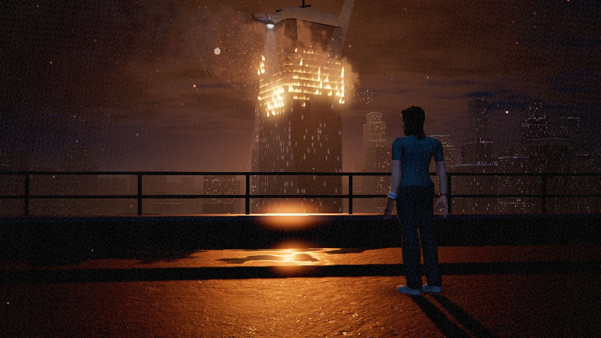
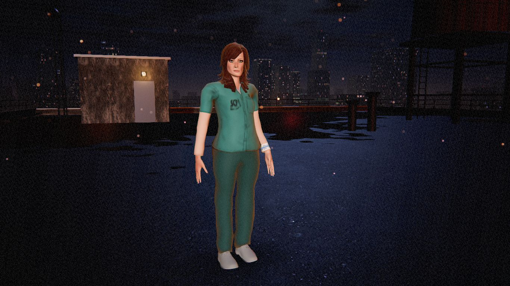
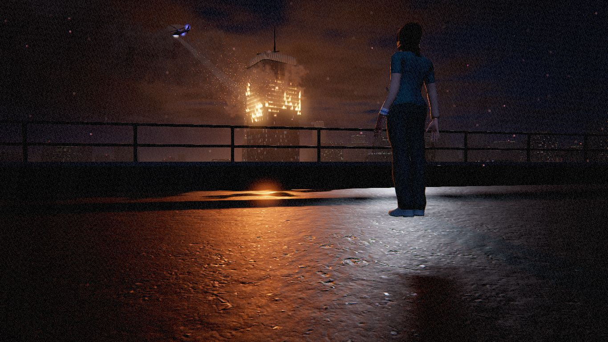
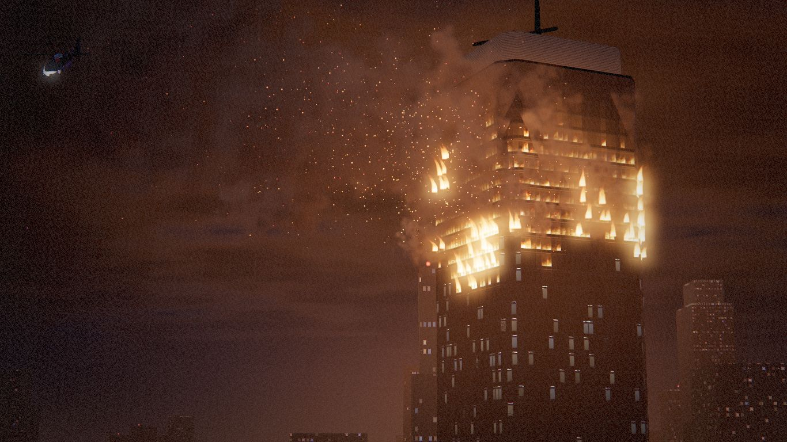
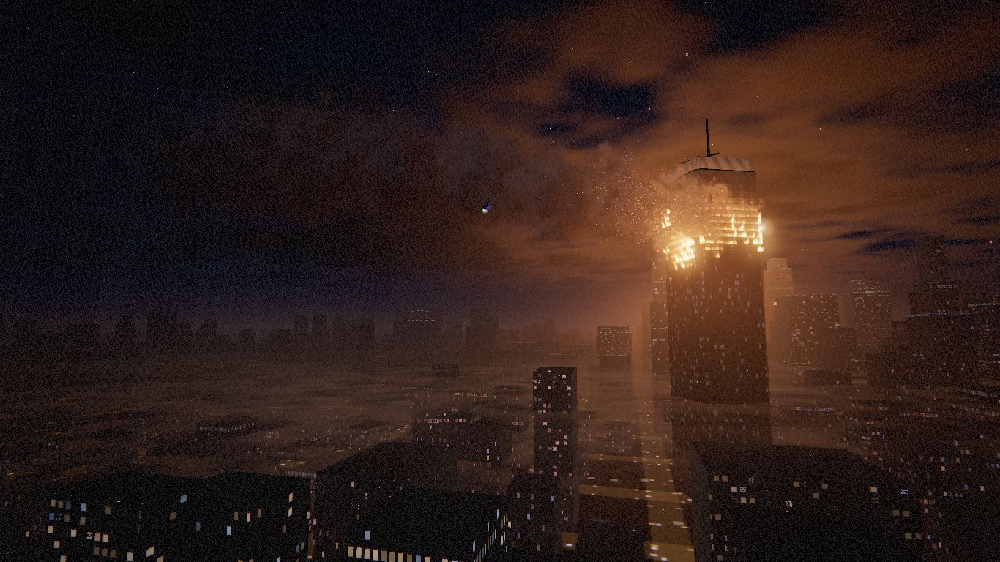
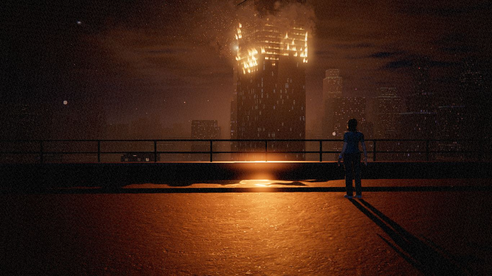
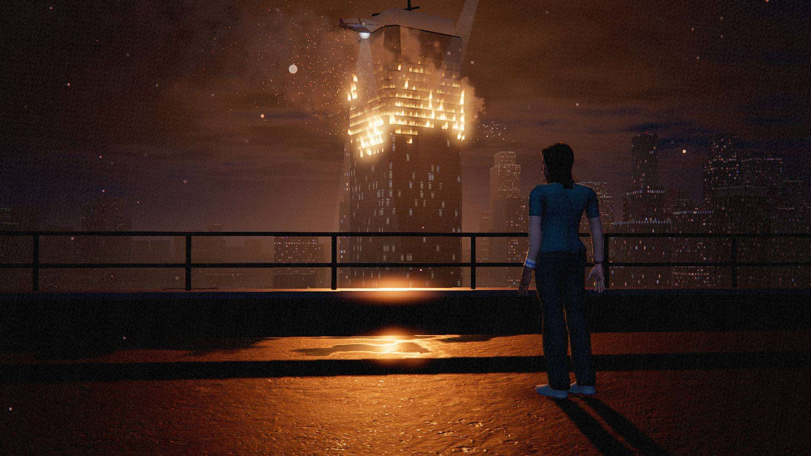

# The menu stage

The menus sit on a live 3D shot: Ascension Tower burning at 3 a.m., seen
from the roof of the building across the street, Subject 07 standing at the
rail. The menu text sits straight on the picture (index.html / styles.css);
this document is about the picture. Code: `src/menu/`.



## What is in the scene

| Part | File | What it does |
| --- | --- | --- |
| Air | `atmosphere.js` | One haze model for every surface: exponential height fog integrated along the view ray (warm sodium murk down at the streets, clean navy higher up), the fire's in-scatter, a moon halo. The sky dome uses the same colours at its horizon, so far towers melt into the sky. Sky: navy gradient, moon and halo, faint twinkling stars, a thin cloud deck lit from below. Also the shared 256² tileable noise texture every effect animates with. |
| The tower | `tower.js` | A chamfered-square glass tower in one draw call. Its facade shader splits faces into floors and window columns (anti-aliased mullions, spandrels, slab edges) and looks *into* each window with interior mapping (ceilings, back walls and floors in true perspective: lit offices with ceiling panels, dark ones with a monitor left on). Each window's state lives in a small texture: how hard it burns, whether its glass is sooted, cracked or gone, whether its lights are on or flickering. Burning rooms are fire under a ceiling of smoke; frames and panels near the fire are lit by it; soot climbs the face above. On the CPU the fire creeps slowly and every 7-16 s a window blows out. |
| Fire | `fire.js` | Flames (one instanced draw: noise-shaped tongues out of blown windows, black-body colour into HDR so the bloom takes them), glow sprites, a ~100-puff smoke plume (CPU-simulated, sorted back to front, lit by the fire from below by distance, the city's glow on the underside and the moon on top, ending in the haze), embers (GPU points, flight computed in the vertex shader), glass shards and a flash for each blow-out. In the foreground: drifting ash and stray embers with a depth-of-field bokeh. |
| City | `city.js` | About 2,000 towers on a street grid in one instanced draw (world-space windows, sparse warm and cool lights, lit crowns, averaged where a window is under a pixel so nothing shimmers); the street grid 96 m below (sodium lamps, traffic both ways); the supplied `city_night.glb` as a downtown cluster; red aircraft beacons; two thin fog sheets between streets and roofs. The left of the title shot is kept low and calm for the menu text. |
| Roof | `roof.js` | Wet tarred-gravel roof (the Roof level's photo textures) with puddles in world space: dark, near-mirror, flattened normals, rain rings, the environment map (captured from this scene) putting the burning tower in them. A low concrete upstand with a steel guard-rail (the street shows through), a timber water tank on a steel stand, condenser units, the stair bulkhead with a caged lamp (a real warm light), an antenna whose red light blinks on the roof, vent stacks, a conduit. |
| Helicopters | `helicopters.js` | Two police helicopters (the model and its bake from `src/fx/police-helicopters.js`). One circles the tower, its searchlight walking the burning floors. One patrols between the roof and the tower; every half minute or so its light comes across our roof and over Subject 07, with a real spot light riding the beam. Beams are soft cones: Fresnel edges, brighter near the lamp, dust drifting through, fading in the haze. |
| Subject 07 | `figure.js` | The player model, its vertex-shader rig and its look (skin, hair) - plus breathing, a weight shift every 6-10 s, loose arms, a slow look round at the camera now and then, the scrubs moving in the wind, a warm Fresnel rim from the fire's side, a shadow cast from the posed body and a contact shadow. |
| Camera | `shots.js` | Named shots, solved from framing constraints, eased between, with a hand-held drift. |
| Stage | `stage.js` | Builds all of it, lights it, captures the environment map, updates it, renders it through the game's post chain. |
| Glue | `backdrop.js` | What main.js talks to: shots follow the menu pages, the figure follows the loadout, fades and fallback. |

### Light

Lit like a film set at night: **key** - the fire, low and warm from across
the street, flickering, flaring with each blow-out, casting Subject 07's long
shadow across the wet roof toward the camera; **fill** - a cool moon from
behind the camera, and a sky/ground hemisphere; **rim** - a Fresnel edge on
the figure from the fire's side; **practicals** - the bulkhead lamp and the
antenna's beacon; the **searchlight** now and then; **reflections** - an
environment map captured from the finished scene (so the puddles hold the
tower). In the Appearance close-up a soft bounce light rides with the camera
so skin and hair read clearly. The rail casts no shadow, nor does the
upstand (the fire is so low that their shadows would black out the roof).
The key light's own highlight is removed from the puddles: the fire is not a
point, its true reflection is the environment map.

## The shots

A shot is a place to stand and what must land where on screen - "Subject
07's head at 30% from the top, feet at 87%, centred 70% across" - and the
camera's yaw, pitch and lens are solved for the viewport's aspect. So the
text column on the left stays clear on any screen shape.

| Shot | Menu page(s) | The picture |
| --- | --- | --- |
| `title` | storyScreen, startScreen | Low behind Subject 07, three-quarter back, figure in the right third (head ~30%, feet ~87%), the tower burning centre, smoke drifting over the calm left. |
| `appearance` | appearanceScreen | Close, three-quarter front, full body centred at ~47%, lit to read skin and hair; the controls stand on the right. |
| `newgame` | newGameScreen | Low behind them, looking up at the burning floors; figure right. |
| `chapters` | chaptersScreen | A long lens up the tower's burning top, tilting slowly up the floors and back; tower in the right half. |
| `endless` | endlessScreen | Wide over the city from the roof's corner, the tower on the right, a slow pan. |
| `dim` | settingsScreen, manualScreen, creditsScreen, reportScreen | The title shot pulled back and slowly pulling out, the picture dimmed (exposure) behind dense text. |
| `versus` | the Versus lobby (`versus.active`) | Along the rail, the tower ahead, a little dimmed. |

Between shots: 2.6 s, ease-in-out; near the figure the camera swings round
them (lifting over the rail's top), never through. With **reduced motion**:
no flight - a short dip through dark and a cut; the drift, the figure's idle
and the fire's flicker are calmer.

| | | |
| --- | --- | --- |
|  |  |  |
|  |  |  |

## API

```js
import { MenuStage, SHOTS } from "./src/menu/stage.js";
const stage = new MenuStage({ renderer, quality: "medium", reducedMotion: false, assetBase,
                              figure: { character: "playerFemale", skin: "light", hair: "natural" } });
await stage.ready;                // or stage.isReady
stage.update(dt, postfx);         // only while the menu shows
stage.render(postfx);             // through src/fx/postfx.js (bloom, tone mapping, grain);
                                  // its uniforms and the exposure are put back afterwards
stage.setShot("appearance");      // see SHOTS
stage.setFigure({ character, skin, hair });   // skin and hair at once; a new body after a quick dip
stage.setQuality("low"); stage.setReducedMotion(true); stage.resize(w, h); stage.dispose();
stage.dim;                        // 0..1, how dimmed the picture is (the "dim" shot)
```

The figure is made in one place, `createFigure({ character, skin, hair,
assetBase })` in `figure.js`. To swap in rigged models with Mixamo clips,
return any object with the same small interface (`root`, `height`,
`setLook`, `update`, `headPosition`, `dispose`); the stage needs nothing else.

From the UI:

- **Shots follow the pages**: `backdrop.js` watches the `.screen` elements'
  `class` (a MutationObserver) and maps the active one (`SCREEN_SHOTS`).
  Anything else can ask: `requestMenuShot(name)` (a window `menu:shot`
  event).
- **The figure follows the loadout**: a window `loadout:change` event with
  `{ character, skin, hair }`. main.js sends it from the body, skin and hair
  pickers (`announceLoadout()`).

## In main.js

- `menuBackdrop = new MenuBackdrop(...)`, `menuBackdrop.preload()` at boot:
  the stage builds and streams in the background (its own loading manager,
  so the menu's loading screen never waits for it).
- `updateGame`, intro branch: `if (menuBackdrop.update(dt, { versus: versus.active })) return;`
  before the old Skyline corridor backdrop - which stays until the stage is
  in, or if it fails.
- `renderFrame`: after Versus and the briefing film,
  `if (state === "intro" && menuBackdrop.render(postfx)) return;`.
- The pickers call `announceLoadout()`; `__dbg.menuStage` for the checks.

During a run nothing calls it: no updates, no draws. Coming back (the body
loses its `pregame` class for a run) cuts to the current shot and fades up
from black. The briefing film, the Versus match and the loading screens draw
before it, as before; music is untouched.

## Performance

Measured at 1366x768, medium (software GL, so counts not times):
107 draw calls / 86k triangles in the title shot, 154 / 74k in the
appearance close-up (the figure's shadow pass), 119 / 105k wide over the
city; ~1,200 points; ~0.25 ms of CPU per update (the smoke sort is the
biggest part). The heavy pixels are the tower facade (interior mapping,
about 10-15% of the screen) and the smoke's overdraw.

What the quality setting changes:

| | low | medium | high |
| --- | --- | --- | --- |
| Post chain | off (the game's low path) | 85% resolution, bloom | full, bloom |
| Key-light shadow | none (contact shadow only) | 1024² | 2048² |
| Searchlight shadow | - | - | 512² |
| Smoke puffs / embers / ash | 55 / 250 / 220 | 90 / 600 / 480 | 120 / 1100 / 800 |
| City reach, fog sheets | 1.6 km, one | 2.4 km, two | 2.8 km, two |
| Rain rings in puddles | off | on | on |
| Environment map | 128² | 256² | 256² |

"Auto" quality runs the stage at medium (the game's frame-rate monitor only
watches runs). Particle counts and the city are fixed when the stage is
built; changing quality later switches shadows and draw ranges. Everything
on the stage is in one scene with its own camera; it shares the renderer
and the post chain with the game and holds roughly 45 textures and 90
geometries while the game runs (freed by `dispose()`).

## Checks

```
node tests/menu-stage/run.js            # boot, every shot, the loadout, a run and back
node tests/menu-stage/run.js --levels   # also: every level starts from the menu and comes back
node tests/menu-stage/run.js --docs     # also: these screenshots (preview/menu-stage.html)
```

`preview/menu-stage.html` shows the stage alone, with a button per shot
(`?shot=title&quality=high&clean&manual&character=playerMale&skin=brown&hair=blonde`).

## Rough edges

- The figure has no skeleton or clips, so the idle is shader-rigged
  (breath, weight shift, head turn, cloth flutter). The real rigged models
  will do this better; `createFigure` is the seam.
- Smoke is billboards, not volumetric: it reads well at the plume's scale,
  less so in the long-lens chapters shot.
- The fog sheets over the street can look like a glassy surface in the wide
  endless shot.
- Frame times were never measured on a real GPU here (the checks run on
  software GL); the budget above is by construction.
