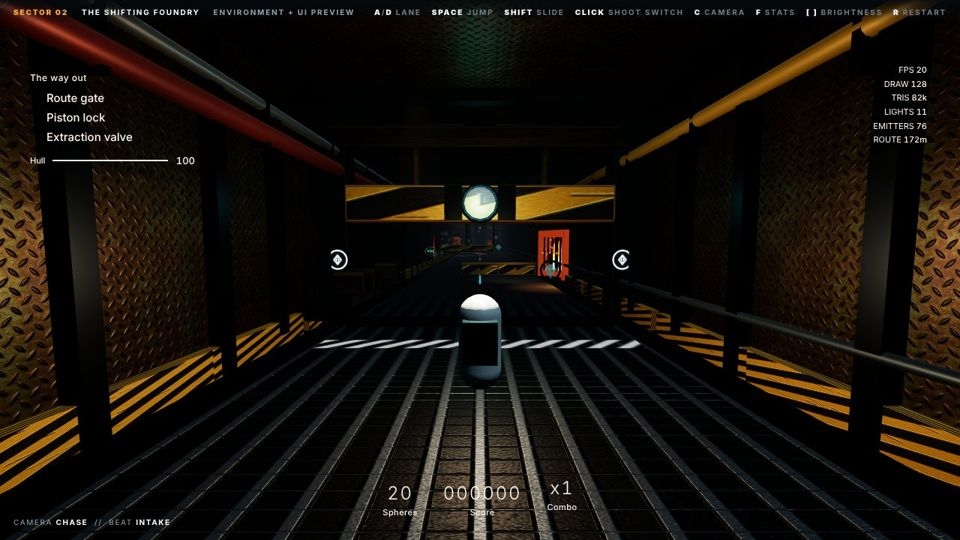
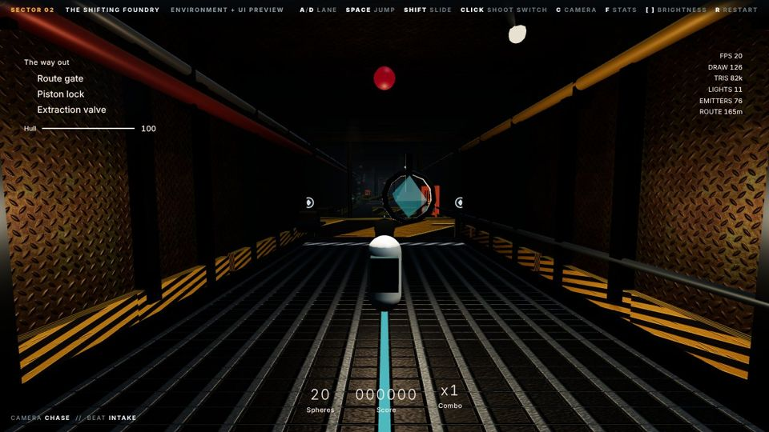
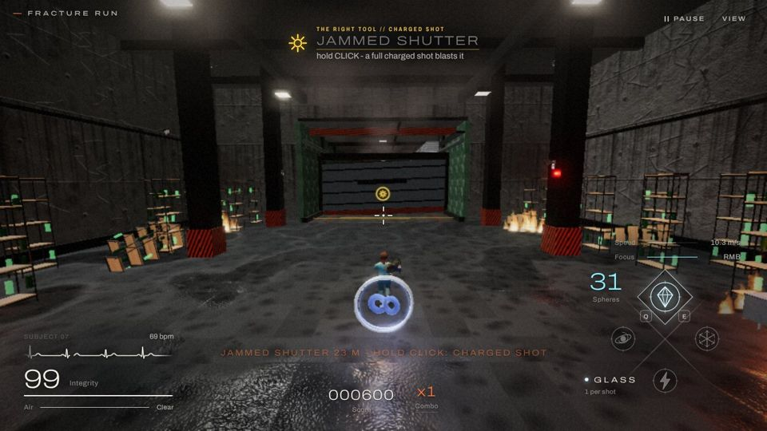
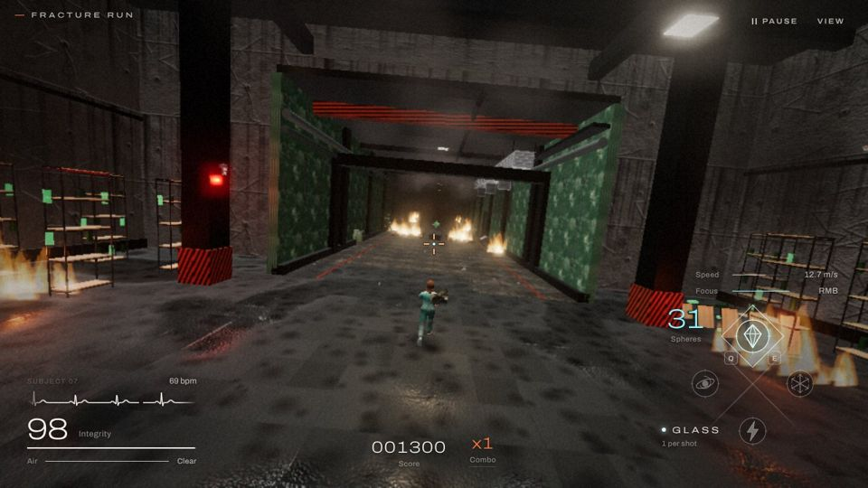
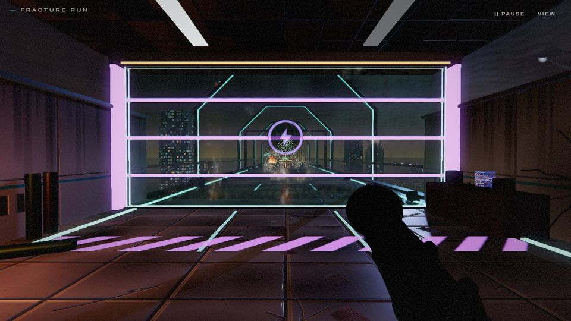
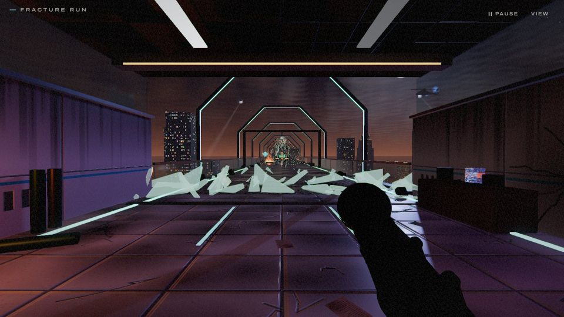
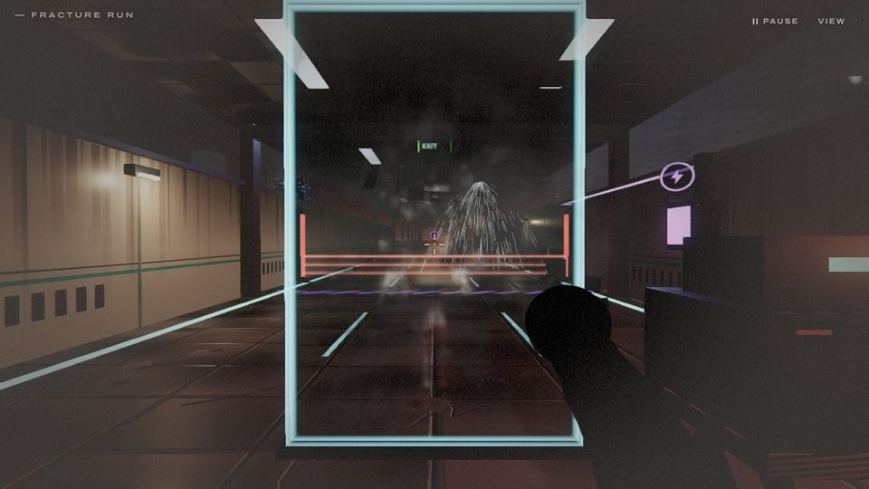
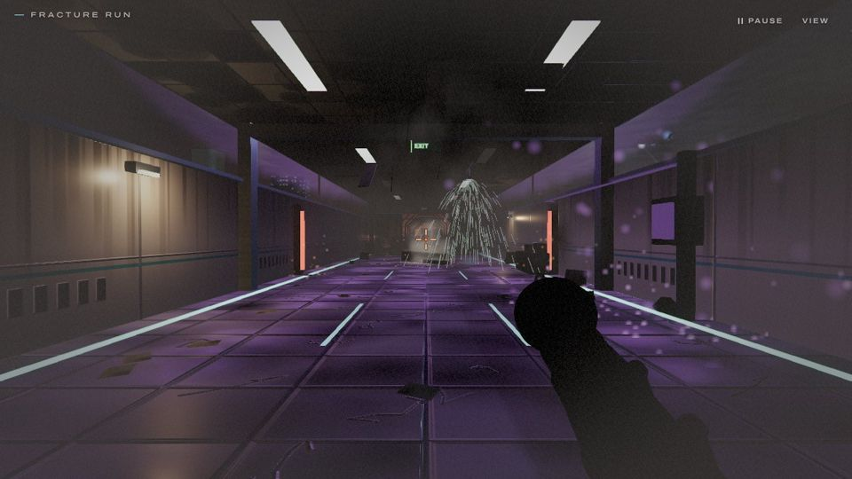
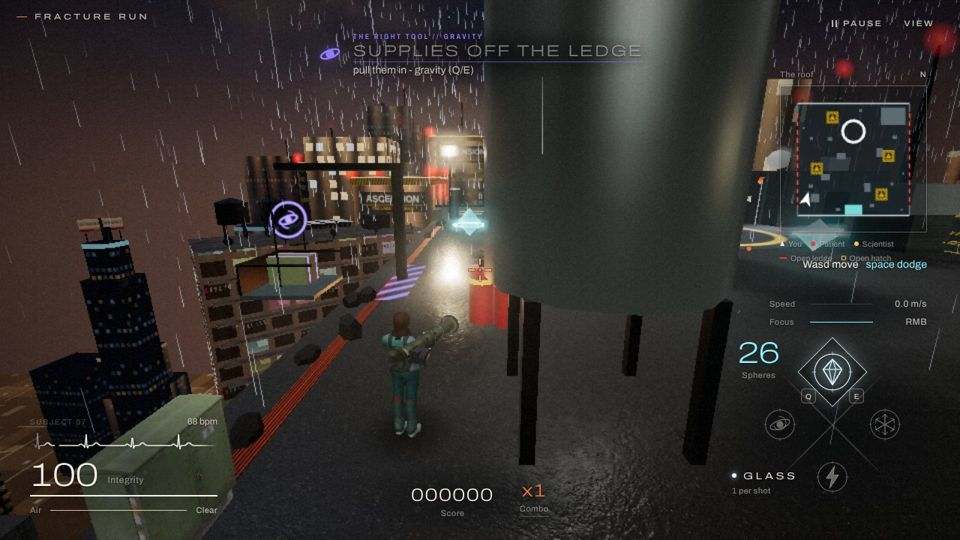

# Problem solving: the right tool

The lecturer's feedback:

> "Incorporate the weapon (sphere) types into the gameplay more, e.g. you have to freeze fire. Otherwise there's no reason to swap."

The spheres are one physical language:

- **glass** shatters;
- **cryo** freezes and puts fire out;
- **shock** overloads electrics;
- **gravity** pulls.

Before, all four were mostly different ways to break glass, so nobody had a reason to swap. Now every sector has obstacles that only the right sphere, the right way of throwing it, or the right moment gets you past. Each sector asks its question in that language, as the sector unlocks the tool.

The team's round 4 gave each sector's sphere something only it does (`progression.js`; `docs/feedback-round-4.md`, row 66). This round adds a second question to each sector:

| Sector | Tool | The problem | The question it asks | From |
| --- | --- | --- | --- | --- |
| 01 The Foundry | glass | **Drop forge** | *When?* | this round |
| 02 The Labs | cryo | **Fire walls** | *Which tool?* | team, round 4 |
| 02 The Labs | the charged shot | **Jammed shutter** | *How do I throw it?* | this round |
| 03 The Skyline | shock | **Security drones** | *Which tool?* | team, round 4 |
| 03 The Skyline | shock | **Sealed security door** | *Which tool?* | this round |
| 03 The Skyline | shock | **Laser grid's junction box** (optional) | *Is it worth it?* | this round |
| The Roof | gravity | **Thrown off the ledge**; the brute; the flying mutant | *Where?* | team, round 4 |
| The Roof | gravity | **Stranded supplies** (optional) | *Where?* | this round |

This round's code:

- `src/systems/problems.js`: the definitions and the log;
- `src/fx/problem-marks.js`: the marks;
- `src/ui/problem-cue.js`: the cue on screen;
- `src/levels/foundry/kit.js` `dropForge`;
- `src/levels/meltdown/problems.js`;
- `src/levels/causeway/problems.js`.

## This round's problems

### The Foundry: the drop forge (glass, *when?*)

| | |
| --- | --- |
|  |  |

A hammer as wide as the corridor slams down on a frame in a steady rhythm. Every 2.8 s it is held up for half the cycle, drops fast, stays down, and lifts more slowly.

- **The solve.** The glass valve on its face is **open only while the hammer is held up**. While the hammer moves, its guard plates close over the valve. Break the valve while it's open and the hammer jams up for good, venting steam: **+500**, and the sphere back.
- **The wrong moment.** Too early or too late, the sphere glances off the guard: *"VALVE SHUT // THROW WHILE THE HAMMER IS UP"*.
- **Without solving it.** Time your run underneath. The hammer is down 35% of its cycle. Under it you take a hit: *"CRUSHED // BREAK ITS VALVE WHILE IT'S UP"*.
- **The clever extra.** Cryo freezes it, but only while it is up. Frozen down, it would be a wall.
- **Where.** Two per run: the intake's exit and the middle of the rolling floor.

### The Labs: the jammed shutter (the charged shot, *how?*)

| | |
| --- | --- |
|  |  |

A blast shutter is jammed across the corridor at the archive's exit. It has a gold meter.

- **The wrong way.** Plain shots only dent it: each one fills the meter a little.
- **The solve.** Hold the throw for **one full charged shot** and the shutter blows out of its frame: **+700**, and its 2 spheres back.
- **Without solving it.** Dent it full and it gives too, but that costs about eight spheres instead of two, and earns no bonus. Run into it and you shoulder through, hurt.

### The Skyline: the sealed security door (shock, *which tool?*)

| | |
| --- | --- |
|  |  |

Violet seal bars run across the ward's security door, at 238 m: between the first drone (60 m) and the next (548 m).

- **The wrong tool.** Glass, cryo and a charged glass burst all bounce off: *"SEALED // GLASS BOUNCES OFF"*.
- **The solve.** One shock sphere overloads the seal and the door shatters: **+600**, and the shock's 3 spheres back.
- **Without solving it.** Shoulder through, for 34 integrity.

### The Skyline: laser grid and junction box (shock, *is it worth it?*)

| | |
| --- | --- |
|  |  |

A laser grid crosses all three lanes. A low grid you jump; a high one you slide under. A violet junction box hung in the middle of it, on a gantry between its posts, feeds it. There are two in the story, at 204 m and 600 m.

*Playtest change:* the box first stood on a pylon off to the side, 8 m before the grid. At running speed, far away and off-centre, most players couldn't hit it. It now hangs over the centre lane, where you're already looking, like the sealed door's seal, and a shock bursting near it (the floor under it will do) counts. (The pictures below show the first version.)

- **The solve.** Shock the box and the grid dies: **+450**, and the spheres back.
- **The alternative.** Jump or slide the grid if you trust your timing. This is the one problem where solving is a choice, not the only way.

### The Roof: stranded supplies (gravity, *where?*)

A crate sits on the window-cleaner's cradle off the open west ledge, out over the drop. Nothing reaches it except a gravity well opened close to it, which drags it in over the ledge, where it bursts open with spheres and a serum: **+500**. Other spheres clang off the steel.

## The rules this round's problems follow

1. **Drawn in its tool's colour.**
   - The colours: glass white, shock violet, gravity indigo, charge gold.
   - Every problem carries that sphere's sign on a disc and hazard stripes on the floor before it.
   - You can read it at running speed, before any words.
2. **It says what it wants once.** The first of each kind gets a cue with the tool's sign, for example *"THE RIGHT TOOL // SHOCK: Sealed security door: glass bounces off - shock (Q/E)"*. With a controller in use, the keys are the controller's. The team's level cards explain their own obstacles before each sector.
3. **The Labs count the shutter down** in the HUD: *"JAMMED SHUTTER 11 M - HOLD CLICK: CHARGED SHOT"*.
4. **The wrong tool visibly fails and says what it needs.** It fizzles, clangs or glances off, rather than doing nothing.
5. **Never a soft-lock.** Every problem that stands in the way can be passed without the tool, at a real cost: a crash, a hit, or eight spheres.
6. **A clear run-up.** The obstacle filler keeps off each problem's last stretch, so nothing stands in the line of fire.
7. **Solving pays.**
   - Each problem has a bonus.
   - The run report counts the problems solved per level.
   - A solve gives back the right tool's cost: a charged shot 2, shock 3, the forge's valve its sphere. The stranded crate bursts into spheres. The clever answer never leaves you poorer than walking into it.
8. **Not in the Race.** The split-screen race is about the line you run, not the tool.

## Why this is problem solving, not reflex

A runner tests reflexes: see it, dodge it. These problems add a read and a decision before the reflex, and each sector adds a different kind:

- **Which tool?** Fire walls, drones, the sealed door.
- **How do I throw it?** The shutter needs a held throw, not a tap.
- **When?** The forge's valve only opens on the beat. A drone's lock gives you a moment to leave its lane.
- **Where?** A gravity well has to be placed by the crate, or by the ledge with the patients in reach.
- **Is it worth it?** The junction box costs 3 shock spheres against the risk of jumping the grid. The shutter is 2 spheres charged against 8 dented.
- **Can I afford it?** Cryo, gravity and shock cost more than glass. Saving them for the problem ahead is part of the run.

The game already had problems of this kind, and they now sit in the same family:

- **The Foundry's switches.** In the rolling floor you choose which pressure to take off: the piston lock, the walls or the pressure bleed.
- **The Skyline's lift gate.** Locks I, II, III must each be hit directly, in order, against the clock.
- **Fire and smoke on the Skyline.** Sprinklers or cryo put out fires; vents clear smoke.
- **The roof's gas canisters.** They chain.

## Checks

The tests play the problems the way a player should, and fail if the right tool doesn't solve them.

- **The Labs** (`tests/meltdown`). The playthrough bot saves two spheres for a coming problem and fires the right tool from its run-up: cryo at each of the team's fire walls, a full charged shot at the shutter. If a patient steps into the line of fire, it throws again, up to three times.
- **The Skyline** (`tests/causeway`).
  - The bot shocks the drones (the team's) and switches to shock for a sealed door or a junction box, then back to glass.
  - It jumps or slides a grid still live as it arrives.
  - It must reach the lift.
- **The Foundry** (`tests/foundry`).
  - The geometry check times each forge: down 35% of its cycle, its valve open 43% of it, never open while the hammer could hit you, and two per run.
  - The balance check runs the level skilfully, sloppily and on Hard. A skilled run still takes no hits.
